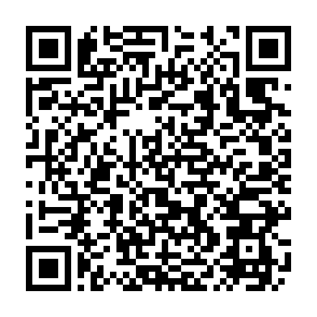

<p align="center">
  
</p>

# Badge Arcade Reclawed

[](https://github.com/giunzione/badge-arcade-reclawed/actions/workflows/build.yml)



**Play Nintendo Badge Arcade again, offline, straight from your 3DS. No PC needed.**

Scan the QR code with **FBI** (Remote Install → Scan QR Code), open **Reclawed Installer** and press **Install**. The app checks your console, picks the right patch for your copy of the game, turns on Luma3DS game patching and restarts. That's it.

Nintendo shut down the game's servers on 8 April 2024. Reclawed is a small [Luma3DS](https://github.com/LumaTeam/Luma3DS) code patch that removes the game's dependency on the network: you can enter the arcade, play the crane machines and the Practice Catcher, get a different set of machines every day of the week and keep the badges you win, with no account and nothing that has to stay online.

<br clear="right">

> [!NOTE]
> This project contains **no Nintendo code or assets**. It ships only an IPS patch (our own instructions), an installer app and helper scripts. > You need your own copy of the game and your own SpotPass data, already on your console.

## Why Reclawed?

Other projects bring Badge Arcade back too. If you want the online experience, with new machines every day, custom badges and a Miiverse-style gallery, have a look at [BadgeCade](https://badgecade.com/), which brings back Badge Arcade's servers.

Reclawed is built around a different idea: **the simplest possible way to get the game running again, on the console alone.**

- **No PC.** Install from the 3DS itself: scan a QR code in FBI, press one button. No SD card juggling, no files to extract, no boot menus to dig through.
- **No server.** The patch works without an internet connection, an account or a server that has to stay online.
- **Safe by default.** Before touching anything the app checks Luma3DS, the game, its region and exact version, and Luma's settings. It backs up your Luma config, changes only the one setting it needs, and can uninstall the patch again.
- **Always up to date.** The app fetches the newest patch for your game version from the latest release, with a built-in copy for offline use. When a new patch drops, open the app and press **Update**.
- **Open source.** The patch, the installer and the research behind them are all in this repository.

---

## Status

| Feature | Status |
|---|---|
| Boot without servers or NNID login | ✅ Working |
| Arcade hall | ✅ Working |
| Crane machines (10 free plays per visit) | ✅ Working |
| Practice Catcher (bonus machine) | ✅ Working |
| Daily machine rotation, with the real system clock | ✅ Working |
| *Extra:* restoring old badges to the HOME Menu badge box | ✅ Optional side tool, [`tools/restore_badges.py`](tools/restore_badges.py) |
| Keeping newly won badges after closing the game | ✅ Working. Stored in the game's extdata as `reclawed`, see [docs/05-home-badges.md](docs/05-home-badges.md) |
| Won badges in the HOME Menu badge box right away, also when opened from the badge book (<kbd>Y</kbd>) | ✅ Working (confirmed on EUR v1.3.1) |
| Theme shop, Miiverse gallery, info corner | ❔ Untested |
| Installer app: install from the console with a QR code, no PC needed | 🆕 New, see [Installation](#installation) |

### Supported game versions

| Region | Game version | Patch | Tested on |
|---|---|---|---|
| EUR | v1.3.1 (with the update) | [`eur-v1.3.1.toml`](patches/eur-v1.3.1.toml) | ✅ Real hardware |
| EUR | Base game, no update | [`eur-noupdate.toml`](patches/eur-noupdate.toml) | 🧪 Test harnesses and emulator only |
| USA | v1.3.1 (with the update) | [`usa-v1.3.1.toml`](patches/usa-v1.3.1.toml) | 🧪 Test harnesses and emulator only |
| USA | Base game, no update | [`usa-noupdate.toml`](patches/usa-noupdate.toml) | 🧪 Test harnesses and emulator only |
| JPN | any | — | ❌ Not supported yet |

"Test harnesses" means every original instruction the patch replaces was checked against that version's code, and the patched code was run in a CPU emulator side by side with the EUR v1.3.1 patch, giving the same results. The installer app itself has so far been tested in the [Azahar](https://azahar-emu.org/) emulator. \
If you try any 🧪 version on a real console, please [open an issue](https://github.com/giunzione/badge-arcade-reclawed/issues) and say whether it worked, with your console model and Luma3DS version.

The original game stored your collection on Nintendo's servers. The patch keeps it in a local file instead, and writes the badges you win to the HOME Menu badge box during the short loading after the last pull of each crane session, just like the online game did while it waited for the server. They show up right away, whether you open the badge box from the HOME Menu or with <kbd>Y</kbd> in the game's badge book.

### Starting from scratch

If you never played Badge Arcade, or your save data is gone, the game starts with the rabbit's tutorial as if it were your first visit. Since v0.2.2 this works offline too: the tutorial crane saves your badge, and once it's done the game treats you as a returning player instead of sending you back to the tutorial.

This case was found and tested by a French 3DS fan who reached out right after the first release. Thank you!

> [!NOTE]
> So far the EUR v1.3.1 patch has been tested on **two consoles** (a returning player and a brand-new save). Setups different from these, for example another SpotPass week in `boss.sarc` or no NNID, haven't been tried yet. \
> If you try it, please [open an issue](https://github.com/giunzione/badge-arcade-reclawed/issues) and say whether it worked, with your console model and Luma3DS version.

### Planned

- **Installer app, next steps.** A listing on Universal-Updater.
- **More built-in machines.** In built-in mode the game offers its default 30 machines. The game's own files hold about 400, and the installer could register them all on the console, from your own copy of the game.
- **Testing on real hardware**: the USA and base-game patches, any SpotPass week other than the two below, and the built-in machines. See [Supported game versions](#supported-game-versions).
- **JPN**: needs the game's code from someone who owns that version. Contributions are welcome.

---

## Requirements

- A Nintendo 3DS / 2DS family console running **Luma3DS** custom firmware
- **Nintendo Badge Arcade, EUR or USA**, either v1.3.1 (the final update) or the base game without the update.
  See [Supported game versions](#supported-game-versions). JPN is **not supported** yet, because the patch addresses differ.
- Best: the game's SpotPass data in its extdata (`boss.sarc`), for the machines of the last week you downloaded (a different lineup every day).
  This is the case if the game was opened at least once while the servers were up.
  Without it, the installer app sets the patch to the game's **built-in machines** instead (the same 30 every day).
- The console must be on its **Nintendo Network ID** account. If you use [Pretendo](https://pretendo.network) through Nimbus, switch back to **Nintendo** before launching the game.

---

## Installation

**Back up first** (recommended, not required). Use [Checkpoint](https://github.com/BernardoGiordano/Checkpoint) to back up the game's extdata. If you have badges in your HOME Menu badge box, also dump them with [Simple Badge Injector](https://github.com/AntiMach/simple-badge-injector): the patched game still runs its own badge-update step at boot, so it's worth keeping a copy. Neither tool is needed for the patch to work.

### With the installer app (no PC needed)

1. Connect the console to the internet, open **FBI**, choose **Remote Install → Scan QR Code** and scan the [QR code at the top of this page](#badge-arcade-reclawed). Confirm the install.
2. Open **Reclawed Installer** from the HOME Menu. It checks your console and lists what it finds: Luma3DS, the game and its exact version, which SpotPass week your `boss.sarc` holds, and Luma's settings. It also looks online for the newest patch for that version; without internet it uses the one built into the app. Anything that blocks the install is shown in red.
3. Optionally, pick the **Machines**: your **SpotPass week** (the default when `boss.sarc` is there) or the game's **built-in** ones.
4. Choose **Install**. The app writes the patch, set up for your SpotPass week and your choice, to `luma/titles/<title id>/code.ips`, and turns on Luma's **"Enable game patching"** (after saving a backup of `luma/config.ini`). Then it restarts the console.
5. Launch Nintendo Badge Arcade.

The QR code always points to the newest release. Without a camera, download `reclawed-installer.cia` from the [latest release](https://github.com/giunzione/badge-arcade-reclawed/releases/latest) and install it from the SD card with FBI. The app's **Uninstall** button removes the patch again. When a new patch comes out, just open the app again: it shows **Update** in place of **Install**, and there's no need to reinstall the app.

If there's no patch for your version of the game yet, the app shows a **Report** button with a QR code that opens a GitHub issue already filled in with your game's details. Details are in [`installer/README.md`](installer/README.md).

### By hand (with a PC)

1. Download the zip for your region and game version from the [latest release](https://github.com/giunzione/badge-arcade-reclawed/releases/latest) (e.g. `badge-arcade-reclawed-EUR-….zip` for v1.3.1, `badge-arcade-reclawed-EUR-noupdate-….zip` for the base game) and extract it to the root of your SD card, so that you get `luma/titles/<title id>/code.ips`.
2. Open the Luma3DS configuration menu (hold <kbd>SELECT</kbd> while powering on) and enable **"Enable game patching"**.
3. Launch Nintendo Badge Arcade.

To uninstall, delete `code.ips`. The installed game is never modified.

> [!WARNING]
> The prebuilt patch in the release zips plays only the game's **built-in machines** (the same 30 every day), never your SpotPass week. Only the installer app can read which week your `boss.sarc` holds. To get your SpotPass machines, either:
> - install with the [installer app](#with-the-installer-app-no-pc-needed), or run it once after copying the zip. It shows *Patch settings will change* and sets the patch up for your week; or
> - build the patch on your PC from your own `boss.sarc`: see [Building for your SpotPass week](#building-for-your-spotpass-week).

> [!TIP]
> The game takes **a long time to load**, especially on *Reading latest data...* after the title screen. On an Old 3DS with a slow SD card this can take about two minutes. Don't panic: it isn't frozen. The game reads its SpotPass badge data in many small pieces at every boot; that's the original game's behaviour, not the patch's.

### Building from source

Each patch is defined as data in [`patches/`](patches/), one TOML per game version (e.g. [`patches/eur-v1.3.1.toml`](patches/eur-v1.3.1.toml)): address, ARM instructions and a description for each change. [`tools/build_ips.py`](tools/build_ips.py) turns it into an `.ips`. Requires Python 3.11+.

```bash
pip install -r requirements.txt
python3 tools/build_ips.py                              # defaults from the TOML [vars]
python3 tools/build_ips.py --set plays=25               # override a variable
```

Each patch carries a small settings block that says which machines the game plays. As built, it selects the built-in machines. The installer app fills it in on the console with the first day of your SpotPass week ([04 – Time](docs/04-time.md#which-week-set-per-console)).

#### Building for your SpotPass week

To build a patch that plays your SpotPass machines without the installer app, point `--spotpass` at your own `boss.sarc`. The script finds the week in it for you, using the same rules as the app; you don't need to open the file or look for any date.

1. Get `boss.sarc` from the game's extdata. With [Checkpoint](https://github.com/BernardoGiordano/Checkpoint): **Extdata** → *Nintendo Badge Arcade* → **Backup**. The backup goes in a folder named after the game under `sd:/3ds/Checkpoint/extdata/`, and `boss.sarc` is inside it. Copy it to your PC.
2. Build:

   ```bash
   python3 tools/build_ips.py --spotpass path/to/boss.sarc                                # EUR v1.3.1
   python3 tools/build_ips.py --patch patches/usa-v1.3.1.toml --spotpass path/to/boss.sarc # another game version
   ```

   It prints the week it found, e.g. `SpotPass week from 2018-07-13: 210 machines on 7 of 7 days`, and stops with an error if the file isn't a usable `boss.sarc`.
3. Copy the `luma` folder from `build/<region>/` to the root of your SD card, as in [By hand](#by-hand-with-a-pc).

`python3 tools/spotpass_week.py path/to/boss.sarc` only shows the week, without building anything. Your `boss.sarc` is Nintendo data: keep it to yourself, and don't attach it to issues.

The output goes to `build/<region>/luma/titles/<title id>/code.ips` (for EUR: `build/EUR/luma/titles/0004000000153600/code.ips`). If you dumped and decompressed your own `.code`, add `--check code.bin` to verify every original instruction before writing.

The Python tools follow PEP 8 with Google-style docstrings, checked in CI with [ruff](https://docs.astral.sh/ruff/) (rules in [`ruff.toml`](ruff.toml)): `pip install -r requirements-dev.txt`, then `ruff check .`. `python3 tools/test_spotpass_week.py` runs their tests.

The installer app lives in [`installer/`](installer/); see its [README](installer/README.md) for how to build it (devkitPro) and its code conventions. [`tools/make_manifest.py`](tools/make_manifest.py) lists the built patches in `patches.txt`, which every release publishes together with the patch files: the app downloads the newest ones and also carries a built-in copy for offline use. Each TOML's `[meta] code_title` / `code_version` say which game version it fits.

---

## Extra: restoring your old badges to the HOME Menu

> [!TIP]
> **This step is entirely optional and unrelated to the patch.** The patch works without it. It's a small side tool that came out of the research, included because it may help someone. Skip it if your badge box is fine.

If your HOME Menu badge box is empty but you used to own badges, they might still be there and simply not be listed. Switching NNID or network (for example to Pretendo) wipes the badge **registry** (`BadgeMngFile.dat`) but leaves the badge **images** (`BadgeData.dat`) in place.

```bash
python3 tools/restore_badges.py <dump_folder> <output_folder> --dry-run   # preview
python3 tools/restore_badges.py <dump_folder> <output_folder>
```

Copy the two files from `<output_folder>` to `sd:/3ds/SimpleBadgeInjector/` and inject them with Simple Badge Injector.

Limitations: quantities reset to 1, and HOME Menu shortcut badges become normal badges. All Pokémon badges end up in a single "Pokémon" set, because their names don't tell the regions apart.

---

## FAQ

**The rabbit asks if my 3DS is brand new.**
The game can't find a Nintendo Network ID. You are probably on a Pretendo account: switch back to Nintendo with Nimbus.

**The hall is empty or has no machines.**
The patch was made for another SpotPass week than the one in your `boss.sarc`. Patches up to v0.5.0 had a fixed week. Run the installer app: it reads your week and installs a patch set up for it. Without the app, [build it with `--spotpass`](#building-for-your-spotpass-week).

**The game stops with an SD card error before the title screen.**
Your extdata has no `boss.sarc`. Run the installer app: it switches the patch to the game's built-in machines. The patch can't bring back the SpotPass machines, because that data belongs to Nintendo.

**Some badges are missing from the collection in built-in mode.**
Built-in mode doesn't load the SpotPass badge catalog (`allbadge.sarc`), so badges that only came with SpotPass data may not be shown. They are still in your save.

**Can you add other regions or versions?**
Possibly. It needs the `.code` of that game version to locate the same functions. Contributions are welcome: add a `patches/<region>-<version>.toml` with its own `[meta] region`, `title_id`, `code_title` and `code_version`, and CI will build it, ship it as a separate zip and offer it to the installer app.

**I won a badge but it's not in the HOME Menu badge box.**
Badges are written to the HOME Menu during the short loading after the last pull of a session; don't turn the console off or press HOME during it. If you pressed HOME during that loading, the badges are added at the next session or the next time you launch the game.

**The badges in the HOME Menu are in a strange order.**
They are placed in the order you won them, not grouped by set. Nothing is lost, you can move them around in the badge box.

**Only 10 plays? Why not 99?**
The claw machines won’t let you leave while you still have unspent plays, so burning through 99 of them becomes a chore fast (trust me, I tried!)

**How does it work?**
See the [technical documentation](docs/).

---

## Disclaimer

This is an unofficial fan project, not affiliated with or endorsed by Nintendo. Nintendo Badge Arcade and all related names and assets are property of Nintendo. Use at your own risk and always keep backups.

This project is a proof of concept, developed iteratively with the help of AI. \
The idea, direction and all testing on real hardware are mine; the reverse engineering, patches and documentation were produced with an AI model.

## Credits

- [3dbrew](https://www.3dbrew.org/wiki/Nintendo_Badge_Arcade): SpotPass and RomFS documentation
- [DaniElectra](https://github.com/DaniElectra/badge-arcade-server): earlier server research
- [AntiMach](https://github.com/AntiMach/advanced-badge-editor): Advanced Badge Editor, whose source documents the HOME badge file format
- The [Pretendo Network](https://pretendo.network) team
- A French 3DS fan, for finding and testing the first-boot case

## License

[MIT](LICENSE), covering the patch and scripts in this repository only.
If you build on this work or share it, a credit or a link back to this repository is appreciated!
